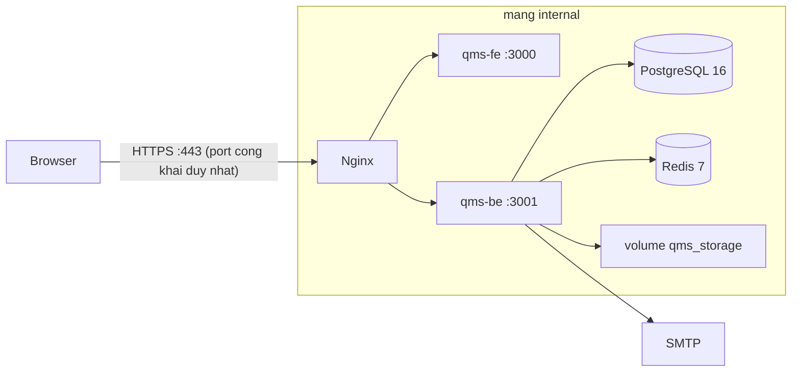

# tmv-qms-docker

Docker Compose, Nginx edge và script vận hành cho **QMS** (`tmv-qms-be` + `tmv-qms`).

Tài liệu này ưu tiên **môi trường phát triển Windows (PowerShell)**. Máy chủ production chạy Linux — xem [Máy chủ production (Linux)](#may-chu-production-linux).

## Yêu cầu (Windows)

| Thành phần | Ghi chú |
|------------|---------|
| [Docker Desktop](https://www.docker.com/products/docker-desktop/) | Backend **WSL2** khuyến nghị |
| PowerShell | **7+** khuyến nghị; script hỗ trợ **5.1** (UTF-8 BOM) |
| Repo anh em | `../tmv-qms-be`, `../tmv-qms` (cùng cấp với thư mục này) |

Bật **File sharing** cho ổ chứa repo trong Docker Desktop (Settings → Resources → File sharing) nếu volume bind báo lỗi.

## Kiến trúc



- **Same-origin**: một host cho `/`, `/api`, `/socket.io`.
- **Postgres / Redis** (production): không publish port ra host.
- **TLS mặc định**: kết thúc tại container `nginx` (`nginx/qms.conf`). Tùy chọn TLS trên host: `nginx/ssl.example.conf` (giống HRM).

## Cấu trúc thư mục

| Đường dẫn | Mục đích |
|-----------|----------|
| `docker-compose.yml` | Stack production (image build sẵn) |
| `docker-compose.dev.yml` | Postgres, Redis, Mailpit local |
| `docker-compose.build.yml` | Overlay build image (tùy chọn) |
| `docker-compose.host-tls.override.yml` | Nginx HTTP-only trên `127.0.0.1:8080` (TLS trên host) |
| `nginx/qms.http.conf` | Cấu hình edge HTTP-only (đi với override trên) |
| `Dockerfile.backend` / `Dockerfile.frontend` | Multi-stage `node:22-alpine`, non-root |
| `nginx/qms.conf` | Proxy, timeout 3 tầng (mục 10.2), WS NAT-safe (5.3), log `rt`/`urt`/`uct` |
| `postgres/init/` | Role `qms_migrator` / `qms_app`, `pg_trgm`, timeout role `qms_app` (10.7) |
| `scripts/*.ps1` | Script host **Windows** |
| `scripts/*.sh` | Script host **Linux** (production) |
| `scripts/docker-entrypoint-backend.sh` | Chạy **trong** image BE |
| `postgres/init/*.sh` | Chạy **trong** lần init Postgres |

### Quyền thực thi và xuống dòng

- **Không phụ thuộc `git +x` trên Windows**: `Dockerfile.backend` luôn `chmod 755` entrypoint sau `COPY`.
- **Postgres init**: file `postgres/init/*.sh` **không cần** bit thực thi; entrypoint Postgres sẽ **source** (`. file`) nếu file không executable — vẫn chạy bình thường. Giữ **LF** (`.gitattributes`).
- `.gitattributes`: LF cho `*.sh`, `*.conf`, `Dockerfile*`, `*.yml`; CRLF cho `*.ps1`.

## Thiết lập lần đầu (Windows)

### 1. File môi trường

```powershell
Set-Location <duong-dan>\QMS\tmv-qms-docker
Copy-Item .env.example .env
# Sua .env — khong commit file .env
```

### 2. Tạo secret (ví dụ)

```powershell
$bytes = New-Object byte[] 48
[System.Security.Cryptography.RandomNumberGenerator]::Create().GetBytes($bytes)
$env:JWT_SECRETS = [Convert]::ToBase64String($bytes)
# Copy gia tri vao .env: JWT_SECRETS (>= 32 byte), mat khau DB/Redis, ...
# Xoay vong: JWT_SECRETS=current,previous (muc 4.15 plan chung)
```

### 3. Chứng chỉ TLS dev (cho `nginx/qms.conf`)

**Cách A — OpenSSL trong Docker** (không cần `openssl` trên PATH):

```powershell
New-Item -ItemType Directory -Force -Path .\nginx\ssl | Out-Null
docker run --rm `
  -v "${PWD}/nginx/ssl:/ssl" `
  alpine/openssl req -x509 -nodes -newkey rsa:2048 `
  -keyout /ssl/privkey.pem -out /ssl/fullchain.pem `
  -days 365 -subj "/CN=qms.local"
```

**Cách B — `New-SelfSignedCertificate` + export PEM** (Windows built-in):

```powershell
New-Item -ItemType Directory -Force -Path .\nginx\ssl | Out-Null
$cert = New-SelfSignedCertificate -DnsName 'qms.local' -CertStoreLocation 'Cert:\CurrentUser\My' -NotAfter (Get-Date).AddYears(1)
$pfxPassword = ConvertTo-SecureString -String 'qms-dev-export' -Force -AsPlainText
Export-PfxCertificate -Cert $cert -FilePath .\nginx\ssl\dev.pfx -Password $pfxPassword | Out-Null
# Doi dev.pfx sang fullchain.pem / privkey.pem bang cong cu ban chon (vd. openssl trong container) — TODO tuy may
```

### 4. Build image (máy dev)

```powershell
.\scripts\build-images.ps1
```

Cần Docker BuildKit và `package-lock.json` ở repo anh em.

Entrypoint BE: `MIGRATE_DATABASE_URL` → `prisma migrate deploy` → (nếu có) `ensure-system-admin.mjs` → `node dist/main.js`.

### 5. Chạy stack production cục bộ (kiểm thử)

```powershell
.\scripts\deploy.ps1
```

## Phụ thuộc dev (Postgres / Redis / Mailpit)

```powershell
docker compose -f docker-compose.dev.yml --env-file .env up -d
```

| Dịch vụ | Endpoint trên host |
|---------|-------------------|
| Postgres | `127.0.0.1:5433` |
| Redis | `127.0.0.1:6379` |
| Mailpit UI / SMTP | `127.0.0.1:8025` / `127.0.0.1:1025` |

Trỏ `tmv-qms-be` vào các URL trên; SMTP dùng Mailpit.

## Nginx và Postgres (theo plan hiệu suất)

**Timeout Nginx** (`nginx/qms.conf`, bảng 10.2): `/api/auth/` **4s**, `/api/` **25s**, `GET /api/files/` **60s**, upload `POST` (attachments/photos/documents) **110s** (`client_body_timeout 60s`, ≥ deadline BE 100s), export **115s**, `/socket.io/` **75s**. Upstream `keepalive 32`, `keepalive_timeout 60s`, `Connection ""` cho HTTP thường.

**Rate limit IP (NAT)**: API **200r/s** burst **400**; upload **5r/s** burst **15** (chỉ `POST` lên `/api/attachments` và `/api/(incidents|ncrs)/…/(photos|documents)`); socket handshake **20r/s** burst **300**; `limit_conn` **400**/IP (API) và **1000**/IP (WS). **`GET /api/files/`** và download dùng zone **api**, không dùng upload (quyết định sản phẩm). Zone **auth** (2r/s) chỉ **login** / **change-password**; `session`/`refresh`/`me` dùng zone **api** (4.9, H14).

**Health**: `/api/health/*` chỉ từ **127.0.0.1** tại Nginx; Internet nhận **403**. Healthcheck container `nginx` gọi **`/nginx-health`** cục bộ, không lộ BE ra ngoài.

**Topology TLS trên host** (Let’s Encrypt trên VPS): đặt `NGINX_EDGE_CONF=./nginx/qms.http.conf`, `TRUST_PROXY_HOPS=2`, chạy `docker compose -f docker-compose.yml -f docker-compose.host-tls.override.yml up -d`, cài mẫu `nginx/ssl.example.conf` proxy tới `127.0.0.1:8080`. Không cần cert trong container `nginx`.

**Log truy cập**: `rt`, `urt`, `uct`, `rid` (`$request_id` của Nginx, gửi sang upstream qua header `X-Request-Id` để khớp `requestId` của BE). Mount `nginx/nginx-main.conf` cho `worker_connections 4096`.

**Che `/internal/`**: Nginx trả **404** từ Internet; metrics chỉ trong mạng nội bộ (4.13).

**Postgres**: `pg_stat_statements`, `max_connections=100`, log chậm 500ms; role `qms_app` có `statement_timeout 10s` (export dùng `SET LOCAL` ở BE).

**Container BE**: `ulimits.nofile 65535`, `stop_grace_period 30s` (deploy êm, 5.11).

**Container FE**: `read_only` + `tmpfs` cho `/tmp` và `/app/.next/cache` (Next standalone).

**Storage `qms_storage`**: volume mặc định có thể **exec** file upload — rủi ro chấp nhận Phase 0; BE **không thực thi** file lưu, phục vụ với `nosniff` + `Content-Disposition`, tên file ngẫu nhiên, ảnh re-encode (khi BE Phase 1). Linux: có thể bind mount thư mục host với `noexec` thay volume (tùy chọn, cấu hình host **UNKNOWN**).

**Biến compose chưa dùng hết ở BE Phase 0**: `STORAGE_DIR` (Phase 1 file/attachment), `SMTP_*` (Phase 3 email). Giữ trong `.env` để deploy sau không phải đổi tên.

**Cron backup**: tránh **02:15**, **03:40**, **06:30** (job app, 10.10).

## Sao lưu / khôi phục (Windows)

```powershell
.\scripts\backup.ps1
.\scripts\restore.ps1 -BackupBundle .\backups\qms_backup_YYYYMMDDTHHMMSSZ.tar -Force
```

Giữ lại **14** bản theo ngày + **8** bản **Chủ nhật** theo tuần (`BACKUP_RETENTION_DAYS` / `BACKUP_RETENTION_WEEKS`). Tham số: `-BackupDir`, `-RetentionDays`, `-RetentionWeeks`.

Mã hóa: `AGE_RECIPIENT` hoặc `GPG_RECIPIENT` trong `.env` (cần `age`/`gpg` trên host).

Sao lưu offsite: tùy chọn — đặt `BACKUP_OFFSITE_DIR` trong `.env` để script copy thêm một bản (đích sync/rsync do vận hành cấu hình, mặc định **tắt**).

Restore yêu cầu xác nhận: gõ `yes`, hoặc `-Force` (ps1) / `--yes` (sh).

## Kiểm tra cấu hình

```powershell
Copy-Item .env.example .env.verify
docker compose -f docker-compose.yml --env-file .env.verify config | Out-Null
docker compose -f docker-compose.yml -f docker-compose.host-tls.override.yml --env-file .env.verify config | Out-Null
docker compose -f docker-compose.dev.yml --env-file .env.verify config | Out-Null
Remove-Item .env.verify
```

`DATABASE_URL` trong `.env` **nên bọc ngoặc kép** khi có `connection_limit` / `pool_timeout` (`&` trong PowerShell/bash khi `source`).

**Kiểm tra `nginx -t`** (cần Docker Desktop đang chạy) — chạy cho **cả hai** edge config:

```powershell
foreach ($conf in @('qms.conf', 'qms.http.conf')) {
  docker run --rm `
    -v "${PWD}/nginx/nginx-main.conf:/etc/nginx/nginx.conf:ro" `
    -v "${PWD}/nginx/${conf}:/etc/nginx/conf.d/default.conf:ro" `
    -v "${PWD}/nginx/ssl:/etc/nginx/ssl:ro" `
    --add-host qms-fe:127.0.0.1 `
    --add-host qms-be:127.0.0.1 `
    nginx:1.27-alpine nginx -t
}
```

## Xử lý sự cố (Windows)

| Triệu chứng | Hướng xử lý |
|-------------|-------------|
| Script `.sh` lỗi `$'\r'` | Đảm bảo LF: `.gitattributes`, `git checkout -- .` hoặc editor lưu LF |
| PowerShell đọc `.env` sai | `Import-QmsDotEnv` trong script `.ps1` đã chuẩn hóa CRLF |
| Volume/bind mount từ chối | Docker Desktop → bật share ổ đĩa; chạy terminal có quyền |
| Port **80/443** bận | Tắt IIS / dịch vụ khác, hoặc đổi `HTTP_PORT` / `HTTPS_PORT` trong `.env` |
| `nginx -t` không resolve upstream | Bình thường khi test lẻ — dùng `--add-host` như trên |
| Không build được BE | Thiếu `scripts/ensure-system-admin.mjs` hoặc `package-lock.json` ở `tmv-qms-be` |

## Header bảo mật

CSP và header ứng dụng do **NestJS Helmet** và **Next.js** phụ trách. Nginx chỉ bổ sung **HSTS** / TLS, tránh trùng CSP.

## PostgreSQL quan sát

Compose bật `shared_preload_libraries=pg_stat_statements` và `log_min_duration_statement=500ms`. `shared_buffers` theo RAM server vẫn **UNKNOWN** (sub-plan Docker).

---

## Máy chủ production (Linux)

Trên VPS: dùng script `scripts/*.sh`, `chmod +x` **không bắt buộc** cho `postgres/init` (Postgres source file nếu thiếu +x). Image BE vẫn `chmod` entrypoint.

```bash
./scripts/build-images.sh    # tren may build
./scripts/deploy.sh
./scripts/backup.sh
./scripts/restore.sh --yes backups/qms_backup_....tar
```

Tuning host: `ulimit -n` ≥ 65535, `worker_connections` 4096, `net.core.somaxconn` ≥ 4096.